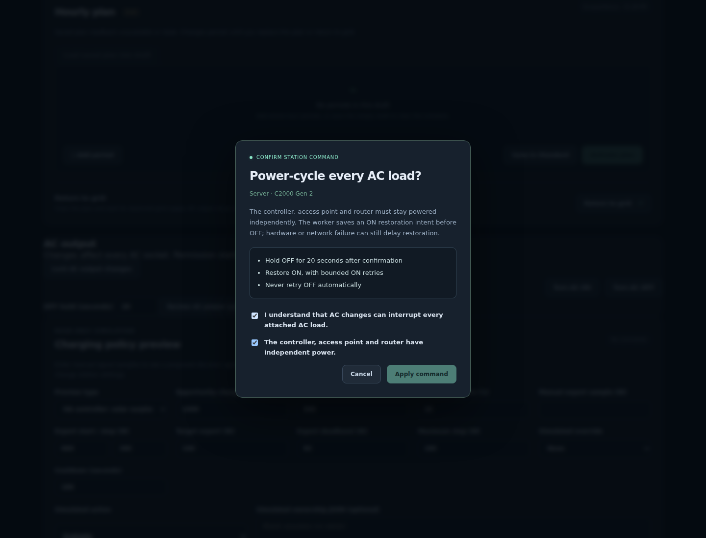

# Guarded C2000 AC output controls

## Support and evidence

Native MQTT AC OFF/ON passed one explicitly authorized **A1783 / main 2.1.6.4**
server recovery on 2026-10-14. [Recorded hardware evidence](c2000-ac-recovery.md)
is separate from the new interface and recovery tests, which use synthetic
stations. No additional live power interruption qualified these interfaces.
The packet is `0101`, typed `A2=01+boolean`, source `A1=22` and the established
FD millisecond timestamp; its acknowledgment is `0901`.

This does not qualify BLE output control, other firmware, DC switching, a
station reboot or electrical waveform behavior. Original/C1000 Gen 2 gateway
output exposure is unchanged. C2000 charging automation remains excluded.

## Permission shared by every interface

**Allow AC output changes** starts **off per station**. The worker and HTTP
gateway must also have controls enabled. Enabling this permission changes only
local metadata; it sends no station setting request. SDK, CLI, terminal,
HTTP/browser and HA commands all pass the worker's permission check.

The owner-only `ac-output-permission.json` is tied to the saved station profile;
missing means locked. Invalid, public-readable, symlinked or mismatched state
fails closed and is preserved for review. Snapshots expose only boolean
`ac_power_control` fields, never the private fingerprint or journal contents.

An HTTP owner uses `POST /devices/{name}/ac-output-permission` with exactly:

```json
{"enabled": true, "acknowledge_high_impact": true}
```

Disabling accepts `enabled:false, acknowledge_high_impact:false`. A legacy
full-owner bearer token can manage permissions. Scoped token files require an
additional explicit `manage_ac_output:["station-name"]` scope, a subset of
their read scope. Command write scopes alone cannot unlock the permission.
Neither HA options nor this endpoint sends AC OFF/ON.

## AC ON, OFF and cycle

After opt-in, `POST /devices/{name}/commands` accepts:

```json
{"command":"set-ac-output","enabled":false,"acknowledge_power_interruption":true}
```

ON uses `enabled:true`; the acknowledgment must still be an explicit boolean.
OFF interrupts **every AC socket**, and stays off until an ON request. Fresh
exact-firmware, typed A4/D9/A7/B2 state is required. OFF additionally requires
AC on, connected mains, DC off, Standard mode, no tariff slots/countdowns and
at least 20% SOC. Each operation performs one write and two fresh full-status
confirmations, preserving A4 except runtime LCD activity and D9 after its
runtime prefix. An uncertain OFF is never automatically repeated.

```json
{"command":"cycle-ac-output","off_seconds":20,"acknowledge_power_interruption":true,"controller_independent":true}
```

The hold is 5–60 seconds, starting after OFF confirmation. Controller, AP and
router must have independent power. The worker saves and fsyncs an ON intent
**before OFF**, serializes the operation, and attempts ON in `finally`, even
after an uncertain OFF. Client cancellation does not cancel the worker cycle.
ON restoration has at most three attempts within a 90-second budget. A valid
pending intent survives worker restart and requests ON upon reconnection;
disabling the permission does **not** revoke that authorized restoration.
Shutdown attempts restoration before closing MQTT/routing. Unconfirmed ON
retains the intent and surfaces `restore_pending`; corrupt/mismatched intent
cannot trigger a request. Network/controller/device failure can still require
physical intervention. A confirmed ON report does not prove that a server has
finished booting, or that its BIOS will power it on automatically.

SDK: `LocalMqttServer.configure_ac_output_permission(...)`,
`set_ac_output_enabled(..., acknowledge_power_interruption=...)` and
`cycle_ac_output(..., controller_independent=...)`. Remote callers share the
existing AP worker; do not create a competing station connection.

```sh
solix-link ap-service-ac-output-permission --directory /private/ap --name ups \
  --enabled on --acknowledge-high-impact
solix-link ap-service-set-ac-output --directory /private/ap --name ups \
  --enabled off --acknowledge-power-interruption
solix-link ap-service-set-ac-output --directory /private/ap --name ups --enabled on
solix-link ap-service-cycle-ac-output --directory /private/ap --name ups \
  --off-seconds 20 --acknowledge-power-interruption --controller-independent
```

The native line menu requires typed confirmation; the full-screen terminal
uses a modal. Remote gateway terminal targets remain read-only. The Vue
dashboard asks for interruption acknowledgment and a separate independent-power
acknowledgment for cycles, with Cancel focused by default.



## Home Assistant confirmation

HA has [dashboard action confirmation](https://www.home-assistant.io/dashboards/actions/).
It belongs to the card action; there is no generic
[switch entity](https://developers.home-assistant.io/docs/core/entity/switch/)
dangerous-action flag that forces a prompt across UI, API and automation calls.
An ordinary switch widget can bypass a particular card's dialog. The worker's
permission continues to apply to every caller.

In SOLIX Link **Configure**, select the station under **Allow AC output changes**
and acknowledge the effect on all loads. Then explicitly enable its **AC output**
switch entity, which starts disabled in the entity registry. Existing AC-state
binary sensors remain read-only. Use explicit ON/OFF actions instead of a blind
toggle. Replace the example entity ID before adding this guarded OFF card:

```yaml
type: button
name: Turn all UPS AC sockets off
entity: switch.example_ups_ac_output
tap_action:
  action: none
hold_action:
  action: perform-action
  perform_action: switch.turn_off
  target:
    entity_id: switch.example_ups_ac_output
  confirmation:
    text: All attached AC loads will lose power. Continue?
```

The separate `solix_link.cycle_ac_output` action takes the station's HA
`device_id`, `off_seconds`, `acknowledge_power_interruption:true` and
`controller_independent:true`. It also needs the same worker permission.
No output automation or dashboard action is activated by installing the code.
